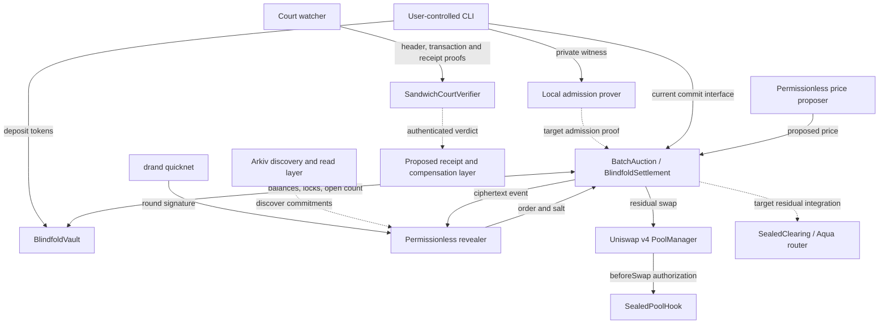
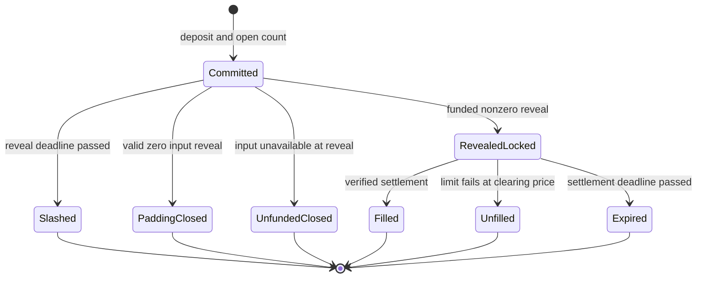
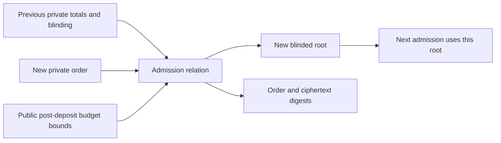
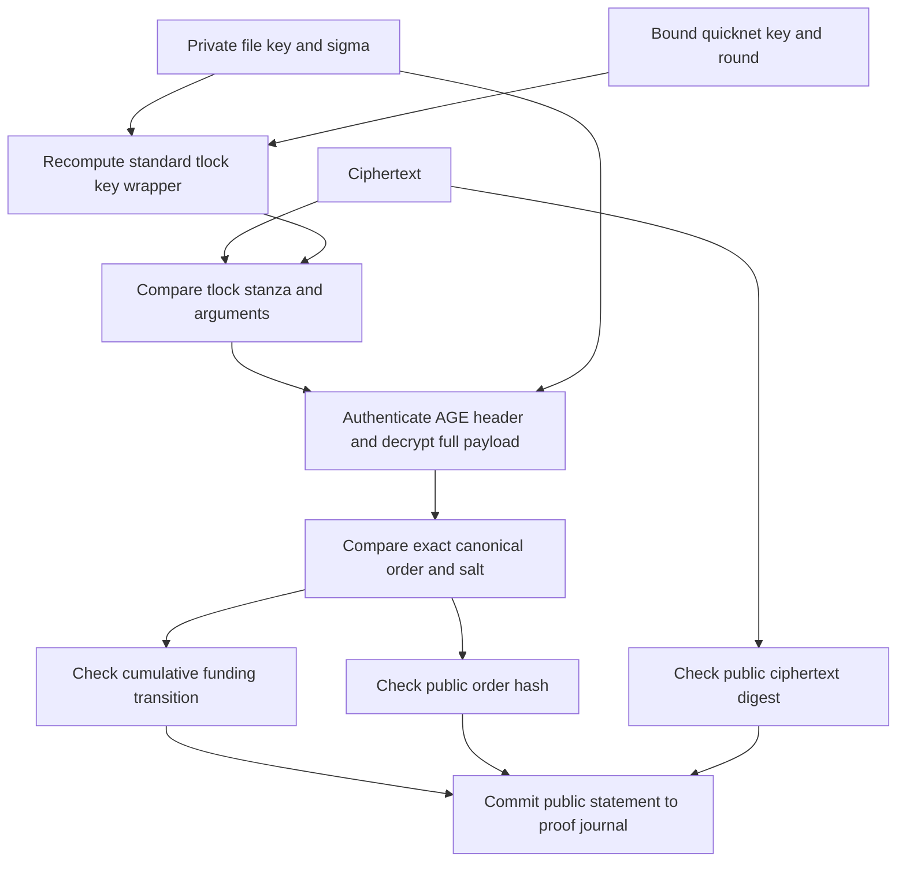
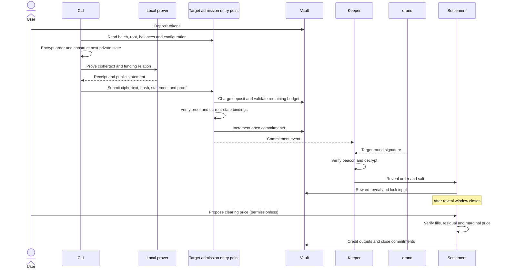
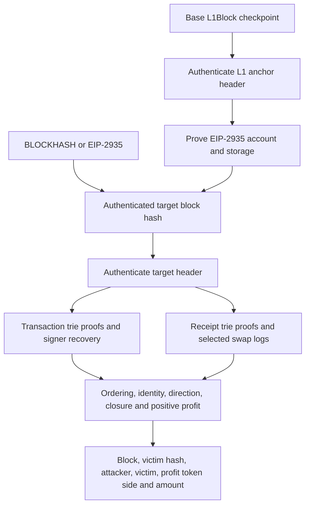
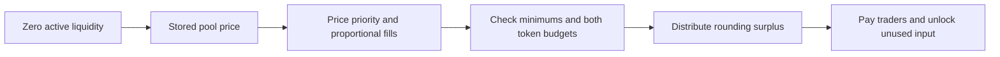

# Blindfold architecture

This document describes the executable contracts, the private funding model, and the admission-proof design as separate layers. Source links identify which layer implements each behavior. The product combines an encrypted batch auction with a separate onchain sandwich-evidence verifier called Court.

The intended auction property is that accepted orders are correctly encrypted for a future public beacon round and cumulatively funded before acceptance. The sender knows its own order. Encryption delays disclosure to other participants; it does not prevent a sender from voluntarily disclosing an order.

## 1. System map



Solid arrows show executable interactions or direct offchain inputs. Dashed arrows show target integration boundaries. They are architectural intent, not a deployment diagram.

| Layer | Source | Responsibility |
|---|---|---|
| Custody | [BlindfoldVault.sol](contracts/src/BlindfoldVault.sol) | Internal balances, input locks, withdrawal restriction, operator transfers |
| Batch lifecycle | [BatchAuction.sol](contracts/src/BatchAuction.sol) | Schedule, commitment records, deposits, reveal, padding, slashing |
| Price and settlement | [BlindfoldSettlement.sol](contracts/src/BlindfoldSettlement.sol) | Uniform-price fills, residual swap, marginal-price check, payouts, expiry |
| Pool authorization | [SealedPoolHook.sol](contracts/src/SealedPoolHook.sol) | Restrict pool swaps to the settlement contract |
| Aqua execution primitive | [swapvm](contracts/src/swapvm/) | Custom instruction and composed router |
| Private funding model | [ReservationModel.t.sol](contracts/test/ReservationModel.t.sol) | Executable model of cumulative private input accounting |
| Admission proof prototype | [proof-bench](packages/proof-bench/README.md) | Native relation, standard ciphertext interoperability, zkVM guest and host |
| Court evidence | [SandwichCourtVerifier.sol](contracts/src/court/SandwichCourtVerifier.sol) | Authenticate block, transactions, receipts and sandwich predicate |
| Evidence builder | [court-watcher](packages/court-watcher/) | Discover candidates and construct claim proofs |

## 2. State ownership and custody

The vault owns token custody and account accounting. The settlement contract is its operator. Users deposit and withdraw through the vault; the operator alone changes internal balances and input locks.

For account `a` and token `t`:

```text
freeBalance(a,t) = balanceOf(a,t) - lockedOf(a,t)
withdraw allowed only when openCommitments(a) == 0
```

The configured asset model uses ordinary ERC-20 transfers with stable balances. Accounting relies on received and sent amounts matching the recorded amounts. The operator is installed once by the vault administrator. The settlement administrator initializes the pool configuration.

A commitment deposit moves from the user's internal balance to the settlement's internal balance. It is separate from the order input. On successful reveal, the revealer receives a configured bounty and the owner receives the remaining deposit. An unfunded reveal sends the remainder to the treasury; an unrevealed commitment can be slashed after its reveal window.

Input tokens stay in the vault. At reveal, funded non-padding inputs become locked. Settlement unlocks and debits filled inputs, routes the net imbalance, and credits outputs. Unfilled orders and expired batches release their locks.

## 3. Timing and lifecycle

The schedule is immutable per deployment: start time, batch length, reveal length and settlement length. The contract uses quicknet's genesis and three-second round period.

```text
commitsClose(b) = start + (b + 1) * batchLength
roundAt(t) = floor((t - genesis) / period) + 1
targetRound(b) = roundAt(commitsClose(b)) + 2
revealOpens(b) = genesis + (targetRound(b) - 1) * period
revealCloses(b) = revealOpens(b) + revealLength
settleCloses(b) = revealCloses(b) + settleLength
```

Commit admission selects the current batch. Reveal and settlement windows include their opening timestamp and exclude their closing timestamp. Expiry begins at the settlement deadline. Batch duration is a benchmark-derived deployment parameter; the test cadence is not a production latency commitment.



This diagram describes economic states. The Solidity `Commitment.status` enum stores only `None`, `Committed`, `Revealed`, and `Slashed`; batch finalization and vault accounting represent the remaining transitions.

Expiry processes funded revealed orders. Unrevealed entries close through `slashUnrevealed`. Reusing these paths keeps cleanup independent of the owner's private admission state.

## 4. Order encoding and public information

An order contains:

```solidity
struct Order {
    address owner;
    bool zeroForOne;
    uint128 amountIn;
    uint128 minAmountOut;
}
```

`zeroForOne` selects token0 input and token1 output. An input of zero is padding. The canonical plaintext and commitment are:

```text
plaintext = abi.encode(order, salt)                         // 160 bytes
orderHash = keccak256(abi.encode(chainId, settlement, batchId, order, salt))
```

The chain, settlement address and batch bind the order to its execution context. The event includes the ciphertext, commitment hash, committer, batch and target round. Ciphertext bytes are event data rather than a stored contract byte array.

Before reveal, public information includes the account, its public vault funding, commitment count and timing, fixed deposits, ciphertext and public proof inputs. The target private inputs are direction, exact amount, limit, salt, encryption secrets and cumulative input totals. After reveal, order details are public.

## 5. Private cumulative funding design

The selected funding architecture tracks actual input totals privately. It does not reserve a public maximum in both tokens for each order.

An account participates in one active batch at a time and can append several commitments within that batch. Each accepted order updates hidden cumulative totals:

```text
T0' = T0 + (zeroForOne ? amountIn : 0)
T1' = T1 + (zeroForOne ? 0 : amountIn)
T0' <= B0
T1' <= B1
```

`B0` and `B1` are public budget bounds. Admission must check them against the account's actual free balances after charging the new commitment deposit. Each new admission therefore rechecks coverage of the entire accumulated obligation, including any reduction caused by another deposit.



The model and prototype use a Keccak commitment over ABI words:

```text
root = keccak256(abi.encode(
    chainId, settlement, owner, batch,
    total0, total1, blinding, step
))
```

Initialization uses zero totals, zero previous blinding and zero previous root. Subsequent admission proves an opening of the stored root. Fresh private blinding hides totals. The step binds progression, including padding. Integer checks bound totals by `64 * (2^128 - 1)` and reject arithmetic overflow.

During the commit window, open commitment count increases monotonically and can supply the step. After admission closes, totals stay append-only: revealing or settling an order does not decrement the private reservation. When all commitments close, the next batch starts from zero. No per-order private release proof is part of this design.

The accounting model executes this policy against the existing auction and vault. It uses plaintext witnesses for testing. The proof prototype checks the private arithmetic relation separately. The production integration boundary is an admission function that atomically charges the deposit, checks current state and budgets, verifies the proof, updates the root and creates the commitment.

## 6. Full ciphertext admission relation

The prototype preserves standard tlock/AGE format and uses the pinned quicknet key and chain identifier. It exposes the upstream tlock computation with explicit private randomness (`sigma`).

The relation checks both the timelock key wrapper and the authenticated payload:



This allows AGE to generate its ordinary file key and payload randomness while proving that the published ciphertext decrypts to the committed order. The checker only supplies the private file key to AGE after the tlock stanza matches the recomputed wrapper. AGE then authenticates its header and entire payload.

| Public statement in prototype | Private witness |
|---|---|
| Chain ID, settlement, owner | Direction, amount, minimum output, salt |
| Batch, round, step | Previous totals and blinding |
| Old root, new root | New blinding |
| Budget bounds | File key and tlock sigma |
| Order and ciphertext digests | Ciphertext bytes checked against the public digest |

The deployment context must bind the token pair, deposit rules, proof program and network configuration. The caller's owner, current batch, scheduled round, current root and actual budget coverage are contract-side checks. A proof of a self-consistent statement is accepted only when that statement matches current contract state.

The benchmark also offers an optional accelerated BLS12-381 backend. It preserves quicknet key-wrapper bytes and uses the same AGE and funding checks. Its adapter is compared against the pinned tlock implementation over varied keys, randomness and rounds; each guest variant has a distinct program identity. See the [benchmark commands](packages/proof-bench/README.md#optional-accelerated-curve-backend).

The CLI runs proving on a user-controlled machine. The benchmark host forces local IPC and disables development receipts. The guest runs the native checker and journals the public statement. The host supports receipt persistence, verification, tampered-journal rejection and a separate Groth16 wrapping command. Its journal currently follows the Rust SDK serialization used by the prototype.

### Selected local admission construction

The admission implementation target uses two specialized local circuits with direct Groth16 verification. The RISC Zero checker remains the executable reference for standard tlock/AGE compatibility. The circuit prototype lives in [`packages/proof-bench/circuit`](packages/proof-bench/circuit/README.md).

1. **Prepare locally for a future batch.** Generate a fresh 16-byte file key, 16-byte sigma and independent 32-byte commitment blinding from the operating system CSPRNG. Prove standard quicknet tlock wrapping and the hiding commitment binding chain, settlement, owner, batch, exact round, network, wrapper and key. The round's hash-to-curve calculation is inside this proof. Each preparation belongs to one eventual order ciphertext.
2. **Choose and prove the order locally.** Build a canonical single-recipient AGE file carrying the five-word ABI payload. Prove its full authentication/encryption, the prepared-key commitment, order hash, ciphertext digest and private cumulative funding transition. Round formatting, base64, header MAC, payload key derivation and final-chunk authentication are constrained. No private witness is sent to a service.
3. **Admit atomically.** The existing opaque `admit(..., bytes proof)` seam carries both proofs and their canonical statements. Settlement requires exact statement lengths, matches their shared 256-byte prefix, checks deployment/caller/batch/round/current funding state and post-deposit capacity, derives the proof inputs and verifies both proofs under pinned verification keys. The state update and existing commitment creation occur only if every check succeeds. With admission enforcement enabled, `commit` cannot bypass the proofs.
4. **Reveal and settle through the existing lifecycle.** Any keeper can decrypt the onchain ciphertext after the authenticated beacon arrives. Reveal, uniform-price settlement, expiration and accounting retain their existing responsibilities.

There is no required proving server, shared-round proof publisher, preparation registry or trusted admission operator. A stateless verifier has no authority to choose the caller, schedule, root or budgets; settlement obtains those from its own state. Per-owner active batch and funding root protect aggregate reservations, and the existing open-commitment count supplies the step and withdrawal lock. Once all commitments close, the next admission starts from canonical zero state.

Preparation journals contain eight ABI words: domain, chain, settlement, owner, batch, round, key commitment and pinned network configuration digest. Online journals add step, old root, new root, budget0, budget1, order hash and ciphertext hash. The two proof inputs for each journal are the high and low 128-bit halves of its Keccak digest. The current online circuit also binds the similarly split digest of its ten-word funding statement; settlement derives that statement from the online journal. Byte encodings and executable commands are specified in the circuit README and the existing independent interop checker.

Both verification keys and their circuit/encoding versions are fixed deployment configuration. Production Groth16 parameters are established through a reviewed multiparty setup ceremony with at least one honest contributor erasing its contribution; clients obtain the authenticated proving parameters for those verification keys. Ceremony parameters are public distribution artifacts, not an online proving service. Benchmark-generated single-party setup parameters are used only for testing.

The client computes preparation before order selection and serializes admissions against the current root and step. It updates its private funding opening after confirming inclusion. An identical ciphertext can be retransmitted or reproved against eligible updated funding state; a changed order or target batch consumes a fresh preparation. The preparation circuit's eight-candidate scalar derivation admits only the standard first valid nonzero candidate; exhausted or zero outcomes require fresh randomness before preparation. The client submits only when proving and inclusion fit before the fixed deployment's commit deadline. Batch selection never changes the scheduled release round after proof creation.

Order contents remain private from observers until release, subject to the pinned beacon's threshold assumption. The sender knows its own order and may disclose it. Owners, timing, public vault activity and ciphertexts remain observable. Correct encryption guarantees decryptability when the beacon is available; keeper participation and timely beacon delivery are separate liveness requirements.

## 7. Commit-to-settlement sequence



The existing contract exposes `commit(batchId, hash, ciphertext)`. The sequence's proof-backed admission entry point is the integration design. The two paths must not coexist as alternative ways to create accepted commitments once proof enforcement is enabled.

## 8. Uniform-price settlement

Prices use raw token units:

```text
p = token1 per token0 * 2^96
sell output = floor(amountIn * p / 2^96)
buy output  = floor(amountIn * 2^96 / p)
```

An order fills when its quoted output is nonzero and meets its minimum. The solver proposes a price; the contract derives the fill set from that price.

Settlement collects filled inputs, computes aggregate obligations and routes one exact-input residual through the sealed v4 pool. The swap must consume the complete residual and return enough to cover owed outputs. Surplus residual output is donated to in-range LPs. The final pool marginal price must satisfy:

```text
abs(poolPrice - proposedPrice) * 10_000 <= toleranceBps * proposedPrice
```

Only after those checks does settlement credit user outputs and close commitments. EVM transaction atomicity rolls back transfers, locks and finalization when any check fails. `expire` provides the existing deadline path for releasing funded revealed inputs.

The hook authorizes settlement as swap caller. Liquidity provision remains a separate pool operation. Deployment creates the settlement first, mines the hook's CREATE2 address with the required permission bits, then initializes the settlement's pool key.

## 9. Aqua / SwapVM boundary

`SealedClearing` reads the settlement's transient active clearing price and requires the settlement as taker. The composed router appends this instruction to the Aqua opcode set. Its opcode is obtained from `sealedClearingOpcode()`.

The settlement exposes the price only during settlement and returns its inverse for the opposite token direction. The current residual implementation routes through v4; Aqua residual routing is a target integration using the existing instruction. Strategy execution and settlement routing are distinct components.

## 10. Court evidence architecture

Court verifies historical evidence independently from the encrypted auction. A claim supplies a block header and front, victim and back transaction legs. Each leg includes transaction bytes, trie proofs, receipt proofs and a log index.



The predicate requires transaction indices `front < victim < back`, front and victim in the same direction, back in the opposite direction, closing size within the configured tolerance, the same front/back signer, a distinct victim signer, and positive attacker swap-leg profit.

The verifier supports legacy and typed transaction signer recovery. It normalizes v4 swap amounts to the pool-side convention used by its predicate. The local Optimism-derived trie/RLP utilities retain attribution; the RLP list reader grows to handle receipts with many logs.

For anchored verification, a checkpoint records an L1 block hash reported by Base's `L1Block`. Account and storage proofs against that anchor recover the historical target hash from Ethereum's EIP-2935 state. The watcher builds these proofs while the RPC can serve the required state.

### Compensation policy boundary

The selected policy is profit-based compensation with token valuation and payout caps. Court's raw swap-leg profit is denominated in the relevant token; it is not automatically an ETH amount or a measurement of victim loss.

The proposed compensation layer binds a signed protection receipt to the verified victim transaction and source chain, authenticates pool/token configuration, values eligible profit, applies policy caps and pays from the accountable provider's bond. Receipt authentication, replay consumption, claim timing, bond withdrawal rules and payout accounting belong to that layer. `verify` itself returns a verdict and performs no payout.

A historical valuation near the incident is an architecture proposal. Feed selection, bond denomination, exact caps and valuation rules require a concrete policy before compensation integration. The older illustrative payout expression in product notes is not an implemented compensation API.

## 11. Discovery, availability and service roles

| Role | Input | Output | Authority |
|---|---|---|---|
| CLI | User order, chain state, local private state | Ciphertext and admission proof | User's signing authority |
| Keeper | Commitment events and beacon signatures | Reveal/slash/expiry calls | Permissionless lifecycle calls |
| Solver | Revealed orders and pool state | Candidate clearing price | Contract checks settlement |
| Court watcher | Ethereum transactions, receipts and proof RPC data | Court claim | Verifier checks evidence |
| Arkiv integration | Events and confirmed outcomes | Discoverable commitments and verdict views | Read/discovery layer |
| Swarm integration | Ciphertext bytes | Content reference | Availability layer |

Onchain state determines balances and outcomes. Index records are discovery aids, not authorization. The ciphertext event provides a canonical publication path. A keeper can reconstruct work from chain events rather than treating an index status as truth.

## 12. Verification workflow

Run shell setup first because this machine defines a recursive `node` function:

```sh
source env.sh
(cd contracts && forge test)
(cd contracts && forge test --match-path test/ReservationModel.t.sol --fuzz-runs 4096)
bash packages/proof-bench/prepare.sh
cargo test --manifest-path packages/proof-bench/Cargo.toml --locked --release
npm ci --prefix packages/proof-bench --ignore-scripts
mkdir -p packages/proof-bench/results
cargo run --manifest-path packages/proof-bench/Cargo.toml --locked --release > packages/proof-bench/results/native.json
node packages/proof-bench/interop.mjs packages/proof-bench/results/native.json
(cd packages/proof-bench/evm && forge test -vv)
```

The [benchmark README](packages/proof-bench/README.md) supplies execution, proving and wrapping commands. Validation is layered:

1. Native relation tests check arithmetic, state transitions and malformed inputs.
2. Independent JavaScript decryption checks standard tlock compatibility and ABI hashes.
3. Guest execution checks that the exact relation runs inside the selected VM.
4. Real proof generation verifies the receipt and submitted journal with development mode disabled.
5. Groth16 wrapping produces an EVM-compatible seal for the same receipt.
6. Solidity verification checks that seal against the intended program and journal; altered inputs must reject.
7. Admission integration checks actual sender, schedule, root, balances and atomic rollback.
8. Repeated end-to-end measurements inform batch cadence and sequential account throughput.

The checked-in Solidity fixture test uses an upstream receipt. Its purpose is verifier plumbing; admission proof verification uses the admission guest's own program identity and receipt. Execution time, proving time, wrapping time and transaction verification gas are different measurements.

## 13. Build and dependency boundaries

- Core contracts compile alongside v4 `PoolManager` with Solidity 0.8.26. Transient storage uses `tstore`/`tload` assembly.
- SwapVM files use their own 0.8.30 and via-IR compilation restrictions.
- The Rust benchmark, zkVM workspace and Solidity verifier benchmark are isolated from production contracts.
- `prepare.sh` pins upstream tlock and RISC Zero verifier revisions. Lockfiles preserve Rust and JavaScript dependency resolution.
- The tlock patch exposes explicit randomness while retaining upstream encryption and attribution. AGE authentication uses the upstream library.

Primary implementation references: [drand tlock](https://github.com/drand/tlock), [tlock-rs](https://github.com/thibmeu/tlock-rs), [tlock-js](https://github.com/drand/tlock-js), [RISC Zero](https://github.com/risc0/risc0), [RISC Zero Ethereum verifier](https://github.com/risc0/risc0-ethereum), [Uniswap v4 core](https://github.com/Uniswap/v4-core), and [EIP-2935](https://eips.ethereum.org/EIPS/eip-2935).


## Peer-only matching when active liquidity is zero

`settlePeer(batchId, marginalId, marginalAmountIn)` crosses opposing funded orders without a pool swap. The contract reads the pool's stored price and requires its active liquidity to be zero. The representative identifies the price-priority boundary: eligible better same-side limits fill fully, equal limits share the input fraction, and worse limits remain unfilled. The boundary fraction may be 100%; zero-minimum orders are supported. Opposing orders retain the ordinary quote rule.



Each base output is rounded down at the reference price, while its proportional minimum rounds up. Execution requires nonzero opposing payouts and independently sufficient token0 and token1 inputs. Rounding surplus is distributed to recipients of that token in proportion to their base quoted outputs; the smallest commitment ID receives the final indivisible remainder. Actual payouts appear in `Filled`, and `PeerSettled` records the reference price and aggregate rounding surplus. The existing finalization, commitment cleanup, and expiration lifecycle applies.

The solver tries this local crossing first when the liquidity view is zero, validates the candidate onchain, and simulates again before sending. It retains AMM search if no peer candidate succeeds; liquidity can exist beyond the current tick even when active liquidity is zero.
