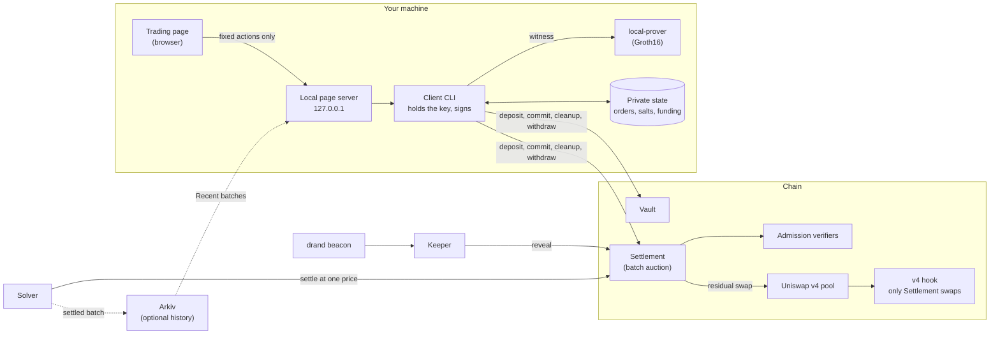

# Architecture

This page covers how the running pieces connect and what happens to one order. The protocol design (timing formulas, the private funding model, the admission proof relation, settlement maths, Court evidence, global auctions) is in [`ARCHITECTURE.MD`](../ARCHITECTURE.MD).

## Components

| Component | Trust | Notes |
|---|---|---|
| Trading page | None: it never signs or sees keys | Talks only to the local server, which accepts a fixed list of actions. See [Security](security.md). |
| Local page server | Local only | Binds `127.0.0.1` and runs one CLI command at a time. |
| Client CLI | Holds your key | Encrypts, proves, signs. Stores your orders and salts locally. |
| local-prover | Sees your witness | Runs on your machine; nothing about the witness leaves it. |
| Keeper | Permissionless | Anyone can run one. It earns the reveal bounty. |
| Solver | Permissionless | Proposes the price; the contract checks it, so a bad price fails. |
| Arkiv | Optional | Only public, already-on-chain batch data. Trading works without it. |

The **Chrome extension** is a second way in: it replaces the CLI and page with wallet signing (MetaMask or another wallet, through a bridge page) and a native prover helper. See [`packages/extension`](../packages/extension/README.md).

## One order, end to end

1. **Fund.** `deposit` moves tokens from your wallet into the vault under your account.
2. **(Optional) Prepare.** `prepare-admission` builds the slow preparation proof for a chosen batch ahead of time.
3. **Commit.**
   - The CLI checks the deployment matches the chain, previews the order, and encrypts it to the batch's drand round.
   - With admission on, it builds the online proof.
   - It saves the order and salt locally **before** sending, then sends `commit` (or `admit`). The vault locks the input and a deposit.
4. **The batch closes.** Commits stop at `commitsClose`. The drand round is published a few seconds later, at `revealOpens`.
5. **Reveal.** The keeper fetches the round, decrypts each ciphertext and calls `reveal`. You can reveal your own order with `cleanup` and keep the bounty. A ciphertext that doesn't decrypt to a valid order is closed (`slashUnrevealed`: slashed, or released with admission on) after `revealCloses`.
6. **Settle.** Between `revealCloses` and `settleCloses`, the solver computes one clearing price, matches the two sides, and routes the remainder through the v4 pool. The contract re-checks limits and the post-swap price. Each order ends filled, partly filled, or unfilled.
7. **Expire.** If nobody settles by `settleCloses`, anyone can `expire` the batch, which unlocks the input.
8. **Withdraw.** When none of your orders is open, `withdraw` moves tokens back to your wallet.

The exact deadlines come from the deployment's schedule; the formulas are in [`ARCHITECTURE.MD` §3](../ARCHITECTURE.MD).

## Contracts

| Contract | Role |
|---|---|
| [`BlindfoldVault`](../contracts/src/BlindfoldVault.sol) / [`AdmissionVault`](../contracts/src/admission/AdmissionVault.sol) | Balances, input locks; withdrawals blocked while a commitment is open |
| [`BatchAuction`](../contracts/src/BatchAuction.sol) | Schedule, commitments, deposits, reveal, slashing |
| [`BlindfoldSettlement`](../contracts/src/BlindfoldSettlement.sol) / [`AdmittedSettlement`](../contracts/src/admission/AdmittedSettlement.sol) | Uniform-price settlement, residual swap, payouts, expiry; the admitted variant verifies admission proofs |
| [`SealedPoolHook`](../contracts/src/SealedPoolHook.sol) | v4 `beforeSwap` hook: only the settlement may swap |
| [`market/`](../contracts/src/market) | External price reference from Uniswap v3 pools |
| [`court/`](../contracts/src/court) | `SandwichCourtVerifier` (on-chain sandwich proofs) and `BondRegistry` (bonds, claims, payouts) |
| [`swapvm/`](../contracts/src/swapvm) | Aqua/SwapVM instruction (not used in settlement yet) |
| [`global/`](../contracts/src/global) | Multi-token global auctions ([`ARCHITECTURE.MD` §14](../ARCHITECTURE.MD)) |

## Private state

The client keeps, per chain, settlement and account, a JSON file under `CLIENT_STATE`. It holds each order and its salt, plus the admission funding state:
- writes are atomic;
- one command at a time holds a lock;
- a lock left by a crashed command is cleared with a note.

`export-state` and `import-state` back it up and restore it; imports are checked against the chain. **The file and backups aren't encrypted at rest** (an open decision in [`CHECKLIST.md`](../CHECKLIST.md)).

## Transactions

Every CLI transaction is sent with an explicit nonce and waits for the deployment's confirmation count (1 locally, otherwise `CLIENT_CONFIRMATIONS`, default 3). It's then classified as:
- **confirmed** or **reverted**;
- **replaced**: another transaction used the nonce;
- **dropped**: the node forgot it and the nonce is unused, so it's safe to resend.

A receipt is reported only if it's still in the same block after its confirmations, which guards against reorgs.
